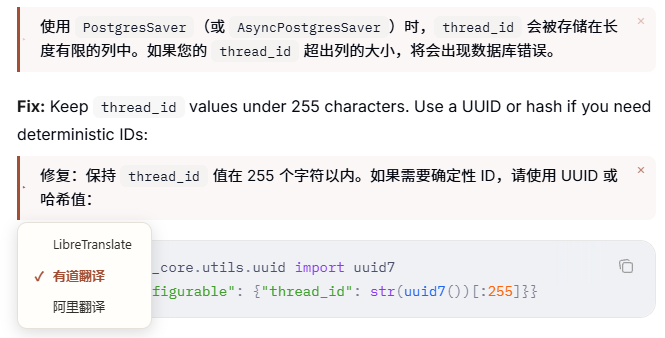
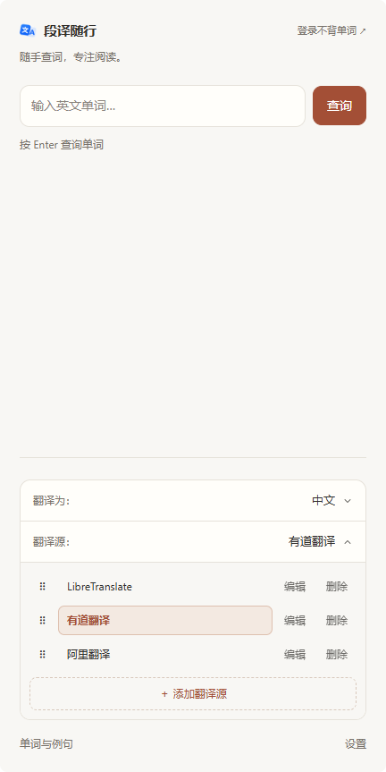
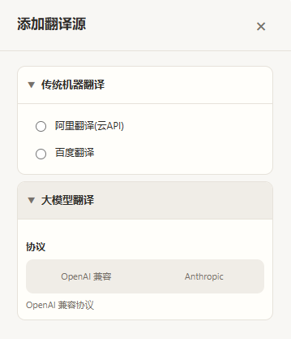

# 段译随行

**选中网页段落，一键翻译，在原文下方对照阅读。**

支持多段文字内联翻译，尽量保留代码与换行。 
通过侧边栏切换翻译源，也可接入兼容 OpenAI 或 Anthropic 协议的大模型。

[快速开始](#快速开始) · [使用效果](#使用效果) · [翻译源配置](#翻译源配置)

## 使用效果

<table>
  <tr>
    <td align="center" valign="top" width="54%">
      
    </td>
    <td align="center" valign="top" width="18%">
      
    </td>
    <td align="center" valign="top" width="28%">
      
    </td>
  </tr>
  <tr>
    <td align="center">段落翻译 · 原文与译文对照阅读</td>
    <td align="center">侧边栏主页 · 翻译源管理</td>
    <td align="center">大模型 API 配置</td>
  </tr>
</table>

选中网页段落，通过右键菜单翻译，译文直接显示在原文下方。支持多段文字，可在译文块上切换翻译源，或点击 `×` 关闭译文。

在侧边栏中选择目标语言、添加翻译源或拖动调整顺序。添加大模型翻译源时，可选择 OpenAI 或 Anthropic 协议，填写 API 地址、Key 与模型，并按需调整翻译提示词。

## 快速开始

### 1. 准备环境

- 安装 **Chrome 116 或更新版本**。
- 下载或克隆本项目，保留包含 `manifest.json` 的完整目录。
- 默认使用有道翻译，目标语言为中文；使用需要凭据的翻译源时，准备对应的 **API 地址与凭据**。

本项目使用原生 JavaScript 和 Manifest V3，**无需安装依赖或构建**。

### 2. 加载扩展

1. 在 Chrome 地址栏打开 `chrome://extensions/`。
2. 启用右上角的「开发者模式」。
3. 点击「加载已解压的扩展程序」，选择包含 `manifest.json` 的项目目录。
4. 将「段译随行」固定到浏览器工具栏，点击扩展图标打开侧边栏。

### 3. 翻译第一段文字

1. 在侧边栏中设置「翻译为」和「翻译源」，也可保留默认设置。
2. 打开普通网页，用鼠标选中一段或多段文字。
3. 右键点击选区，选择「段落翻译」。
4. 等待译文出现在原文下方，对照阅读。

> 段落翻译由右键菜单触发，仅选中文字不会自动开始段落翻译。段落翻译无需登录账号。

## 翻译源配置

打开扩展侧边栏，展开「翻译源」，点击「添加翻译源」选择服务类型并填写配置。

| 翻译源 | 配置方式 |
| --- | --- |
| 传统机器翻译 | 直接选择已有翻译源，或添加对应服务并填写 API 凭据 |
| 大模型翻译 | 选择 OpenAI 或 Anthropic 协议，填写服务地址、API Key、模型与翻译提示词 |

大模型翻译源支持自定义展示名称和提示词，可在侧边栏中添加、修改或删除。实际可用性、调用额度与费用由对应服务决定。

## 可选辅助功能

扩展也支持在侧边栏输入英文单词或在网页中划词查看释义，点击发音图标播放英音或美音。

不背单词的生词添加与单词本同步仅为作者个人使用需求提供适配，属于可选辅助功能，可以完全不使用，不影响段落翻译与查词。

